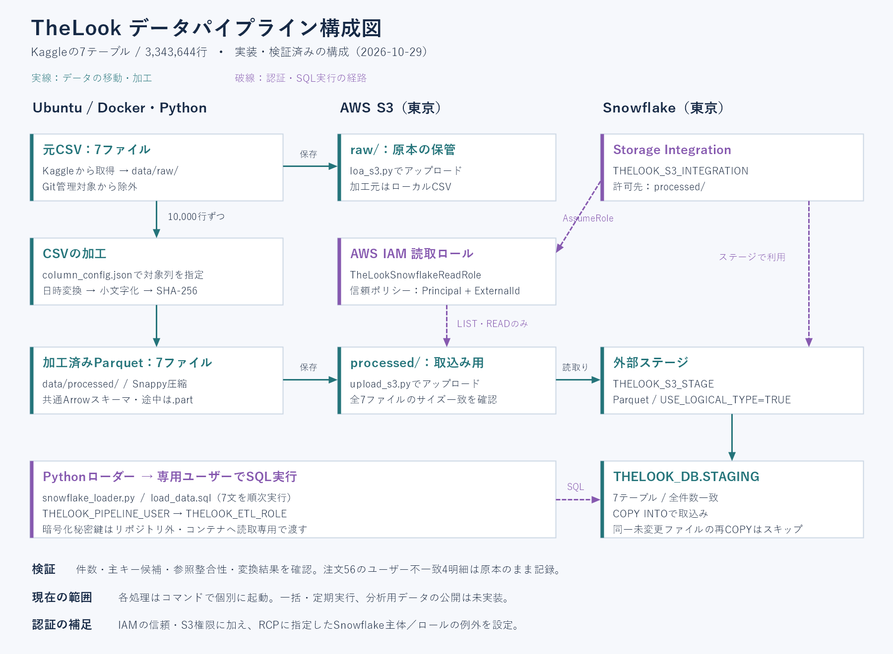

# TheLook eCommerce データパイプライン

TheLookのeコマースデータ7テーブルを対象に、JSONで定義した加工ルールに従ってCSVを加工し、Parquet形式でAWS S3へ保存した後、Snowflakeへ取り込むデータパイプラインです。各処理はDocker上のPythonから実行でき、取り込み前後の件数やデータ品質を確認するSQLも用意しています。

## この成果物で確認できること

- 加工処理とテーブル別の対象列を分離したJSON設定。
- 10,000行単位のCSV加工と、共通スキーマを使ったParquet出力。
- 元データと加工データのS3保存、Storage IntegrationによるSnowflakeからの読取り。
- 専用サービスユーザーの鍵認証によるCOPY SQLの順次実行。
- 正常系だけでなく、列名誤記・書込途中の不正値・SQL途中エラー時の停止の確認。
- 参照先が存在しても残る業務上の不一致を発見し、自動修正せず記録した判断。

各処理を個別のコマンドで起動する構成です。全工程の一括実行・定期実行・監視通知は未実装です。本成果物は学習演習であり、本番運用実績を示すものではありません。

## 構成図



加工元はローカルのCSVです。S3のrawは原本の保管用であり、現実装はS3 rawからCSVをダウンロードして加工する構成ではありません。

## データと検証結果

データの取得元：[Kaggle TheLook eCommerce](https://www.kaggle.com/datasets/daichiuchigashima/thelook-ecommerce)

| テーブル | 行数 | 列数 |
| --- | ---: | ---: |
| distribution_centers | 10 | 4 |
| products | 29,120 | 9 |
| inventory_items | 487,901 | 12 |
| orders | 124,923 | 9 |
| order_items | 180,952 | 11 |
| users | 100,000 | 15 |
| events | 2,420,738 | 13 |
| 合計 | 3,343,644 | 73 |

#### 確認済みの結果：

- 全7テーブルのCSV加工後の保存・読戻し・Snowflake格納件数が一致。
- 全7テーブルの主キー候補のNULL・余分な重複行は0。9つの参照で非NULL値の参照先欠落は0。
- 全12日時列でUTC型と元の欠損数を保持。文字列加工の期待値照合と、加工対象外列の値の一致を全件確認。
- S3の全7CSV・全7Parquetでローカルとサイズが一致。
- 同じ未変更ファイルの再COPYがLOAD_SKIPPEDとなり、件数が増えないことを確認。
- Pythonローダーの実CLIで一時テーブルに初回10行ロードし、途中SQLエラー時に後続が実行されないことも確認。

### 既知のデータ品質課題

注文56は、orders.user_id=56に対し、明細88〜91のorder_items.user_id=44です。どちらのユーザーも存在するため、参照整合性の検証だけでは検出できません。正しい値を断定せず、原本を保持しています。顧客別の集計では、どちらを採用するかによって結果が変わります。

events.user_idには1,124,065件のNULLがあります。すべて匿名ユーザーであるとは断定していません。

### 実測値

- 元CSV：526,472,778bytes。加工後Parquet：239,016,879bytes（約54.60%減）。加工内容も異なるため、純粋な形式だけの圧縮比較ではありません。
- 手動COPYの経過時間：products約3秒、events約17秒。性能ベンチマークではありません。
- 直近3日間の反映済みウェアハウス計算履歴：THELOOK_WH 0.586875 credits。個別COPYの費用や保存料等を含む総請求額ではありません。

## 使用環境

- Windows上のWSL2 Ubuntu、Docker Engine、Docker Compose。
- Python 3.12.16-slim。
- pandas 3.1.0、PyArrow 26.0.0、boto3 1.43.119、snowflake-connector-python 5.1.0。
- AWS CLI v2（作業時2.39.0）。
- AWS S3とSnowflake：東京リージョン。

直接依存はrequirements.txt、推移的依存を含む使用版はrequirements.freeze.txtに記録し、Dockerは後者からインストールします。これらは演習時に確認した版であり、将来の環境での動作や別PCでの再現を保証するものではありません。

## ディレクトリ

```text
.
├── config/
│   ├── column_config.json
│   └── snowflake_config.json
├── docker/
│   ├── Dockerfile
│   └── docker-compose.yml
├── src/
│   ├── cleansing/
│   │   ├── cleaning_data.py
│   │   └── main.py
│   └── loaders/
│       ├── loa_s3.py
│       ├── upload_s3.py
│       └── snowflake_loader.py
├── sql/
│   ├── snowflake_setup/
│   ├── aws/
│   ├── ddl/create_tables.sql
│   ├── copy_into/load_data.sql
│   └── validation/
├── docs/
│   ├── architecture.png
│   ├── pipeline_design.md
│   └── rbac_design.md
├── data/                     # Git対象外
│   ├── raw/
│   └── processed/
├── requirements.txt
└── requirements.freeze.txt
```

## 設定と認証

### 環境に合わせて変更するもの

現在のSQL・設定・コマンドには演習環境の識別子を含みます。別環境ではAWSアカウント・ロールARN・バケット名、Snowflakeアカウント・ユーザー等を変更してください。

- 加工対象列：config/column_config.json。
- Snowflake接続先：config/snowflake_config.json。
- S3バケット・IAMロール・Integration・SQLの対象：sql/snowflake_setup/、sql/aws/、sql/copy_into/。
- 下記アップロード例のbucket変数と、AWS認証のプロファイル名。

JSON変更だけで対応できるのは、実装済み加工の対象列の変更です。新しい種類の加工にはPython実装も必要です。

### 初期設定の順序

既存の演習環境では設定済みです。以下は新規環境用の手順の整理であり、一式を空の環境から再構築する検証は未実施です。

1. S3バケットを作成し、公開アクセスをブロック。raw/・processed/を保存先とします。
2. sql/snowflake_setup/01_roles_and_permissions.sqlでロール・WH・DB・スキーマを作成。
3. AWS側にprocessed配下の読取用IAMロールを作成。
4. 02_storage_integration.sqlを実行。DESCで得たIAMユーザーARNとExternalIdをAWSロールの信頼ポリシーへ設定。
5. 組織のRCP等がある場合は適用内容を確認。保存したRCPは今回の環境の記録であり、他の組織へ無条件に適用しません。
6. 03_external_stage.sql、sql/ddl/create_tables.sqlでファイル形式・ステージ・7テーブルを作成。
7. 04_pipeline_user.sqlで専用ユーザーを作成し、環境ごとの公開鍵を登録。登録文のプレースホルダーは要置換です。
8. config/snowflake_config.jsonを環境に合わせ、実接続主体とIntegrationのREAD/LISTを確認。

CREATE ... IF NOT EXISTSは既存定義を更新・照合する仕組みではありません。既存環境では不要な再実行をせず、変更内容を確認してください。

### 権限の範囲

- ETLロール：STAGINGで取込み用オブジェクトを作成し、自ら作成したオブジェクトを所有。
- 分析ロール：ANALYTICS等のUSAGEまで。分析向けテーブル・ビューとSELECT権限の整備は未実装。
- SnowflakeからS3への連携：専用の読取ロールとStorage Integration。S3書込・削除権限は付与しません。
- ローカルからのアップロード：現状はAccountFullAccessRoleの一時認証。アップロード用の専用権限への絞込みは未実施。

詳細は[権限設計書](docs/rbac_design.md)を参照してください。

### 秘密鍵

暗号化した秘密鍵はリポジトリ外の`$HOME/.config/thelook/snowflake/rsa_key.p8`に置き、権限600で保持しています。コンテナへは`/run/secrets/snowflake_key.p8`として読取専用で渡します。パスフレーズをJSONやGitへ保存しません。

鍵の新規作成・公開鍵登録は[Snowflake公式の鍵ペア認証手順](https://docs.snowflake.com/en/user-guide/key-pair-auth)と04_pipeline_user.sqlを参照してください。既存環境での再生成・上書きは不要です。

## 実行手順（Ubuntu）

以下はリポジトリのルートで実行します。既に保存・ロード済みの環境で、確認のためにすべてを再実行する必要はありません。

### 1. データ配置とDocker準備

Kaggleから取得したCSVを次の命名で配置します。

```text
data/raw/thelook_ecommerce.<テーブル名>.csv
```

```bash
mkdir -p data/raw data/processed
export LOCAL_UID="$(id -u)"
export LOCAL_GID="$(id -g)"
docker compose -f docker/docker-compose.yml build
docker compose -f docker/docker-compose.yml run --rm pipeline python -m pip check
```

LOCAL_UID/LOCAL_GIDはコンテナの実行ユーザーをUbuntuユーザーに合わせるために使います。新しいターミナルでは再設定します。

### 2. CSV加工とParquet保存

まず1テーブルの例です。

```bash
docker compose -f docker/docker-compose.yml run --rm pipeline \
  python /app/src/cleansing/main.py \
  --table users \
  --input /app/data/raw/thelook_ecommerce.users.csv \
  --output /app/data/processed/users.parquet
```

全7テーブルを処理する場合：

```bash
(
  set -e
  for table in distribution_centers products inventory_items orders order_items users events; do
    docker compose -f docker/docker-compose.yml run --rm pipeline \
      python /app/src/cleansing/main.py \
      --table "$table" \
      --input "/app/data/raw/thelook_ecommerce.${table}.csv" \
      --output "/app/data/processed/${table}.parquet"
  done
)
```

初期設定では10,000行単位で処理します。`--config`と`--chunk-size`でも指定可能です。正常終了前は.partに書き込み、正常終了後に正式ファイルへ置き換えます。

### 3. S3へ原本とParquetを保存

AWS CLIのthelookプロファイルを用意し、ブラウザー認証後に主体を確認します。

```bash
aws login --profile thelook --remote
aws sts get-caller-identity --profile thelook --no-cli-pager
```

アカウント・権限・保存先を確認してからアップロードします。以下は今回の保存先の例です。同じキーへ再実行するとオブジェクトを再アップロードします。原本の世代管理は実装していません。

```bash
(
  set -e
  export LOCAL_UID="$(id -u)"
  export LOCAL_GID="$(id -g)"
  eval "$(aws configure export-credentials --profile thelook --format env)"
  docker compose -f docker/docker-compose.yml run --rm -T \
    -e AWS_ACCESS_KEY_ID \
    -e AWS_SECRET_ACCESS_KEY \
    -e AWS_SESSION_TOKEN \
    -e AWS_DEFAULT_REGION=ap-northeast-1 \
    pipeline python -u - <<'PYTHON'
from pathlib import Path
import boto3
from src.loaders.loa_s3 import upload_raw_to_s3
from src.loaders.upload_s3 import upload_file_to_s3

tables = [
    'distribution_centers', 'products', 'inventory_items',
    'orders', 'order_items', 'users', 'events'
]
bucket = 'thelook-pipeline-keisuke-20261028'
s3 = boto3.client('s3')

for table in tables:
    files = [
        (Path(f'/app/data/raw/thelook_ecommerce.{table}.csv'), 'raw', upload_raw_to_s3),
        (Path(f'/app/data/processed/{table}.parquet'), 'processed', upload_file_to_s3),
    ]
    for path, prefix, upload in files:
        key = f'{prefix}/{path.name}'
        upload(str(path), bucket, key)
        metadata = s3.head_object(Bucket=bucket, Key=key)
        if metadata['ContentLength'] != path.stat().st_size:
            raise RuntimeError(f'サイズ不一致: {key}')
        print(f'サイズ一致: {key}', flush=True)
PYTHON
)
```

raw保存とprocessed保存はそれぞれ個別に実施・検証済みです。上記は既存の2関数の呼出しを説明用にまとめた例で、まとめたコマンド自体の再実行検証は未実施です。一時認証情報はコンテナ内で自動更新しません。

### 4. Snowflakeへロード

```bash
(
  set -e
  export LOCAL_UID="$(id -u)"
  export LOCAL_GID="$(id -g)"
  read -r -s -p '秘密鍵のパスフレーズ: ' SNOWFLAKE_PRIVATE_KEY_PASSWORD
  printf '\n'
  export SNOWFLAKE_PRIVATE_KEY_PASSWORD
  docker compose -f docker/docker-compose.yml run --rm \
    -e SNOWFLAKE_PRIVATE_KEY_PASSWORD \
    -v "$HOME/.config/thelook/snowflake/rsa_key.p8:/run/secrets/snowflake_key.p8:ro" \
    pipeline python -u /app/src/loaders/snowflake_loader.py
)
```

既定の接続設定は/app/config/snowflake_config.json、SQLは/app/sql/copy_into/load_data.sqlです。必要に応じて--config、--sqlで変更します。

7文のCOPYを順に実行し、クエリIDと結果を表示します。現在のautocommit構成では、途中で失敗しても、それ以前に確定したCOPYは取り消されません。LOAD_SKIPPEDは既ロードファイルのスキップで、取込データ不良による失敗とは区別します。

### 5. 検証

Snowsightで次のSQLを実行し、結果を確認します。

| ファイル | 期待する結果 |
| --- | --- |
| sql/validation/01_counts_and_keys.sql | COUNT_MATCHESが全TRUE、KEY_NULLSとDUPLICATE_EXTRA_ROWSが全0 |
| sql/validation/02_references.sql | MISSING_COUNTが全0 |
| sql/validation/03_business_consistency.sql | 既知のユーザー不一致4明細、商品不一致0、注文個数不一致0行 |

これらは既に実施した確認をファイル化したもので、生成したSQLファイル自体の再実行は未実施です。SELECTがNG結果を返しても実行を自動失敗させる仕組みではありません。日時型・欠損・文字列加工・元CSVとの照合の詳細は[パイプライン設計書](docs/pipeline_design.md)を参照してください。

## 再実行・既知の制約

- COPYのロード履歴によるスキップには適用条件と保持期間があります。変更されたファイル、履歴失効、テーブル再作成を含む普遍的な重複防止ではありません。
- SHA-256ハッシュはソルトなしです。完全な匿名化を保証するものではなく、氏名・住所等を含むデータ全体の匿名化も実施していません。
- 日時の全値と小数秒の独立照合、メモリ使用量の実測、別PCでの再現、全7テーブルの新規環境からの再構築は未検証です。
- 分析層の公開、一括実行・スケジュール、品質判定の自動化、アップロード権限の絞込み、更新データの差分取込は今後の改善候補です。

## 公開対象・留意事項

元データ・加工済みデータ・秘密鍵・.env等はGit管理対象から除外します。データの再配布可否は未確認のため、リポジトリへ含めません。環境固有の識別子はサンプルとして残しているため、利用時に変更が必要です。


## 設計資料

- [全体構成図](docs/architecture.png)
- [パイプライン設計](docs/pipeline_design.md)
- [権限・認証設計](docs/rbac_design.md)
